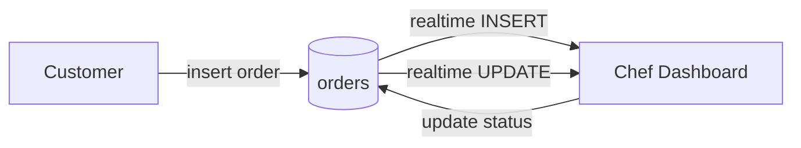

# Café Menu Application

Digital café menu and ordering system built with Next.js 16 (App Router), TypeScript, Tailwind CSS, and Supabase. Customers browse the menu, build a cart, and submit orders that appear on a chef dashboard with realtime updates. Administrators manage menu items, homepage sections, tables, café settings, and chef accounts.

## Technology stack

- Next.js 16.4.3 (App Router, Turbopack)
- React 19.3.0
- TypeScript 5
- Tailwind CSS 4
- Supabase (`@supabase/ssr`, `@supabase/supabase-js`)
- lucide-react, qrcode

## Pages, routes & features

### Public
- `/` — Customer menu: hero, featured dishes, category navigation, menu items, favourites, perfect-together suggestions, cart drawer, table selection, checkout, order confirmation.
- `/qr` — QR code page for sharing the menu.

### Admin
- `/admin/login` — Admin authentication.
- `/admin` — Admin dashboard: menu management, homepage favourites, perfect-together, tables, settings (WhatsApp number), chef account management.

### Chef
- `/chef/login` — Chef authentication.
- `/chef` — Chef dashboard: incoming orders, realtime updates, status updates, completion animation, connection indicator.

### API
- `/api/admin/chef` — Server route for chef account creation/reset (service role).

## Environment variables

| Variable | Required | Server-only | Purpose |
|---|---|---|---|
| `NEXT_PUBLIC_SUPABASE_URL` | Yes | No | Supabase project URL |
| `NEXT_PUBLIC_SUPABASE_ANON_KEY` | Yes | No | Supabase anon key |
| `SUPABASE_SERVICE_ROLE_KEY` | For admin chef ops | Yes | Service role key used server-side only |

## Database

Tables: `cafe_settings`, `homepage_favourites`, `perfect_together`, `orders`, `chef_accounts`. RLS enabled. See `supabase/migrations/`.

Migrations:
- `001_cafe_settings.sql` — ensures singleton café settings row.
- `002_homepage_sections.sql` — homepage favourites and perfect-together tables + RLS.
- `003_orders.sql` — orders table + insert policy.
- `004_chef_accounts.sql` — chef accounts table + RLS.
- `005_orders_rls.sql` — tightened select/update RLS for admin/chef.

## Installation

```bash
npm install
cp .env.example .env.local
# fill env vars
npm run dev
```

Run migrations in Supabase SQL editor in order 001–005. Enable `public.orders` in `supabase_realtime` publication. Bootstrap admin UUID `8102fac5-eae6-4c8e-8062-488454f2ad3f`.

## Scripts

- `npm run dev` — dev server
- `npm run build` — production build
- `npm run start` — start production
- `npm run lint` — lint

## Architecture

Customer submits order ? Supabase `orders` insert ? Realtime `postgres_changes` INSERT ? chef dashboard adds order. Chef updates status ? UPDATE event ? dashboard updates in place. Fallback polling every 12s.



## Security

- RLS on all tables; service role key server-only.
- Admin UUID-based authorization.
- Chef accounts active flag.

## Known limitations

- No automated tests present.
- Admin UUID hardcoded in migrations and code.

## Troubleshooting

- Orders not appearing: verify realtime publication, RLS, auth session.
- 1006 socket close: check auth token, single client instance, cleanup.
- Build failures: run `npm run build`.